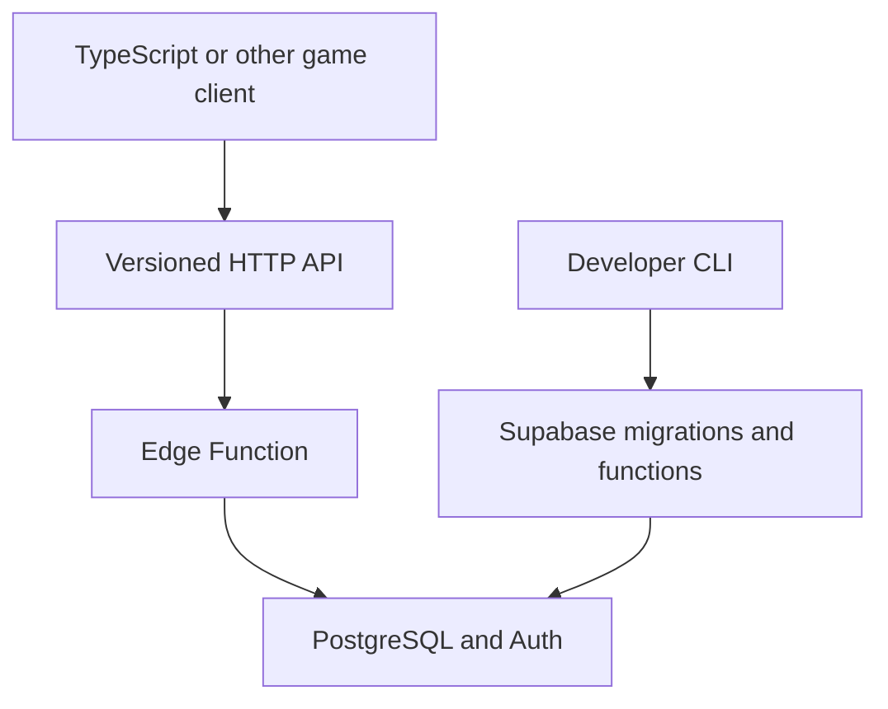

A self-hosted, MIT-licensed, open-source toolkit for adding game leaderboards to a developer's existing Supabase project. The developer uses a command-line tool to provision services, while games use a stable HTTP API or a thin language SDK at runtime.

**Status:** Draft for review, 8 November 2026. **First implementation:** anonymous players and leaderboards, verified with a standalone browser consumer. "Supagame" is a provisional working name, not a confirmed package name.

The first-PR scope correction replaces the provisional native-game consumer with
a generic browser demo. No native platform or device test is a v0.1 release gate.

# Goals and boundaries

**Goals**

- Install a usable leaderboard backend with a short, repeatable CLI workflow.

- Require no hosted service controlled by the toolkit maintainers: each developer owns their Supabase project and data.

- Offer an engine-independent HTTP contract and a TypeScript SDK first.

- Give players a usable identity without a registration screen, while accepting existing Supabase-authenticated users.

- Keep security, migrations, upgrades, and documentation suitable for public adoption.

**Not in v0.1:** achievements, cloud saves, multiplayer, friends, seasons, replay verification, live leaderboard pushes, cross-project aggregation, a hosted admin dashboard, or native Unity/Godot clients. Those are future modules or SDKs, not promises of the first release.

# Approaches considered

| Approach | Benefit | Tradeoff | Decision |
| - | - | - | - |
| CLI installs Supabase-native components; games use an HTTP API | Project-owned, versionable, cross-platform, minimal central infrastructure | Requires Supabase CLI integration and migration discipline | **Selected** |
| Client-only package with copy-paste SQL setup | Fastest initial prototype | Installation and security configuration remain manual | Rejected |
| Hosted management service and web dashboard | Friendly GUI and centralized management | More hosting, authentication, operations, and support burden | Deferred |

The CLI is mostly a setup and maintenance tool; normal player traffic never goes through the CLI.

# System architecture



**Provisioning:** The CLI creates or updates project files, declarative leaderboard definitions, SQL migrations, and an Edge Function. It invokes supported Supabase CLI operations for deployment.

**Runtime:** The game authenticates with Supabase and calls a public HTTP API implemented by a Supabase Edge Function. Reads use PostgreSQL queries/RPCs; score submissions use a narrowly scoped database function that performs validation and an atomic best-score update. The backend remains identical when additional language SDKs are written.

# Developer setup and commands

Proposed command syntax, not yet implemented:

```bash
npx supagame init
npx supagame add leaderboards
npx supagame leaderboard create level-1 --type time --order asc --keep-best
npx supagame deploy
```

- `init` checks for an existing Supabase project, links to the intended project, and creates a small toolkit manifest. It must not overwrite unrelated files.

- `add leaderboards` stages module migrations and function code.

- `leaderboard create` records a version-controlled definition, including a unique slug, integer score type, ordering, validity bounds, and best-score retention policy.

- `deploy` shows the intended migrations and destination, then explicitly confirms remote changes. Repeat runs detect already-applied versions.

- `doctor` checks authentication settings, API reachability, deployed versions, database grants, and module configuration.

- `upgrade` is reserved for future backward-compatible module migrations. No destructive resets or automatic deletion.

The CLI should use the existing Supabase project structure and official CLI where possible. Authentication settings such as anonymous sign-ins are checked; if permissions or tooling cannot safely change them, installation reports exactly what the developer must enable.

# Runtime API contract

A versioned function route is proposed under `/functions/v1/supagame/v1` (public names may change before release):

| Verb and route | Meaning | Access |
| - | - | - |
| `GET /leaderboards` | List active boards | Public |
| `GET /leaderboards/:id/entries?limit=50&cursor=...` | Ranked entries | Public |
| `GET /leaderboards/:id/me` | Current player's best score and rank | Authenticated |
| `POST /leaderboards/:id/scores` | Submit a score; update personal best only if improved | Authenticated |
| `GET /players/me` | Current player profile | Authenticated |
| `PATCH /players/me` | Update a display name | Authenticated |

Request and response bodies use JSON and stable, documented error codes. Pagination is cursor-based, bounded, and deterministic. Submit accepts an integer score and client-generated idempotency key; the server derives the player ID from the verified session, never from client-provided data. Responses distinguish accepted bests, valid non-improvements, and rejected submissions.

Scores are 64-bit integers (such as milliseconds or points). The board defines `asc` or `desc`; ties share the same competition rank, ordered for display by achievement time and a stable ID.

# TypeScript SDK and language portability

```typescript
const game = createGameServices({ supabase });
await game.players.ensureAnonymousSession(); // reuses an existing signed-in session
await game.leaderboards.submit("level-1", 42500);
const top = await game.leaderboards.getTop("level-1", { limit: 10 });
const mine = await game.leaderboards.getMine("level-1");
```

The TypeScript client reuses the application's Supabase client to handle authentication and token refresh, translates API responses into typed results, and exposes no privileged operations. Other clients (C#, GDScript, etc.) implement the same published HTTP contract. HTTP access remains supported without any SDK.

# Identity and player profiles

- An anonymous Supabase Auth user is the default on first use, with session persistence delegated to the host platform's Supabase client/storage adapter.

- An existing signed-in Supabase user is reused; the toolkit must not replace that session with an anonymous one.

- The server treats both anonymous and permanent users as authenticated identities with a UUID. Linking a Google/email identity later uses Supabase's existing identity-linking capabilities, when the project enables the relevant settings.

- A lost unlinked anonymous session may not be recoverable on another device; documentation states this plainly.

- Player display names are separate from authentication identifiers. Apply length/character validation and a basic hide/disable mechanism; do not promise comprehensive content moderation in v0.1.

- Installing the module validates that anonymous sign-in is enabled and explains required configuration if it is not.

# Database model

Use a dedicated toolkit schema for non-exposed implementation helpers, exposing only the minimum API-facing functions and resources.

| Entity | Essential fields | Rule |
| - | - | - |
| `game_players` | `user_id` (Auth UUID), `display_name`, `created_at`, `hidden` | One record per user |
| `game_leaderboards` | `id` (slug), `kind`, `sort_direction`, `min_value`, `max_value`, `enabled` | Created/managed by trusted CLI migrations |
| `game_best_scores` | `leaderboard_id`, `user_id`, `score` (BIGINT), `achieved_at`, `submission_key` | At most one current best per user per board |
| `game_submission_events` | `user_id`, `leaderboard_id`, `submission_key`, `outcome`, `created_at` | Bounded audit/idempotency and rate-limiting support |

Use foreign keys, uniqueness constraints, indexes aligned with each board's ranking direction, and a transactional conditional upsert so simultaneous submissions cannot worsen an existing best. Individual score history and analytics retention are out of scope; event metadata may be purged under a documented retention policy.

PostgreSQL is the source of truth. Leaderboard definitions are version-controlled locally and deployed as additive migrations; changing a board's ranking semantics requires an explicit migration rather than silent reinterpretation of existing scores.

# Security and validation

**Public clients:** only Supabase project URL, publishable key, and their own session JWT. Never distribute secret/service-role keys.

**Authorization:** read-only public access is limited to enabled, non-hidden entries. No client gets direct write privileges on leaderboard definitions or score tables. The Edge Function validates caller authentication using supported Supabase mechanisms; a carefully audited, restricted PostgreSQL submission function derives `auth.uid()` and makes the update transactionally. All security-definer helpers use an explicit safe search path and narrowly scoped grants.

**Validation:** reject nonexistent/disabled boards, non-integer or out-of-range values, oversized requests, duplicate submissions with conflicting payloads, and excessive submission frequency. Optional game-specific validation hooks can be added later. Server timestamps and player IDs are authoritative.

**Threat model:** anonymous accounts and plausible scores are not proof of legitimate gameplay. A modified client can fabricate plausible scores; rate limiting and range checks mitigate abuse, but do not eliminate cheating. Future replay/server-authoritative verification remains a separate module.

**Operations:** bounded queries and input sizes, structured logs without exposing tokens, CORS configuration for supported web clients, and clear status/error codes.

# Versioning and compatibility

- Semantic versions for the CLI and TypeScript package; an explicit schema/module version record in each installed project.

- Versioned HTTP routes, with contract tests ensuring SDK compatibility across supported backend versions.

- Generated migrations are committed by the developer; never rewrite an applied migration.

- `doctor` reports drift and mismatches. `upgrade` produces and previews a migration before application.

- No automatic destructive changes. Removal and data retention require a separate opt-in process.

- One Supabase project corresponds to one game installation in v0.1. Multi-game tenancy can be designed later.

# Verification and release criteria

A local Supabase integration environment verifies: fresh installation, repeated installation, safe upgrade, anonymous sign-in, permanent-account reuse, score submission, non-improving score, concurrency, deterministic ranking/ties, pagination, idempotency, invalid values, auth failures, RLS isolation, and no client-side admin access.

An example TypeScript browser application demonstrates a complete first-launch-to-leaderboard flow. Documentation includes a five-minute quickstart, endpoint schemas, configuration reference, security model, troubleshooting guide, limitations, and copyable SDK examples.

**V0.1 is complete when:** a new developer can install the leaderboard module into their own Supabase project, create two differently ordered boards, authenticate a new anonymous player, submit/read scores from both TypeScript and raw HTTP, and verify security and upgrades with passing automated tests.

# Delivery order and remaining choices

1. Bootstrap CLI and a local Supabase test fixture; install schema and one board definition.

2. Secure submission function and ranked-read API; test auth, RLS, concurrency and errors.

3. TypeScript SDK with anonymous-session helper; use the standalone browser demo as the reference consumer.

4. Add maintenance commands, upgrade checks, release packaging, and complete docs.

**Provisional builder decisions:** single-project installation, best-score-only storage, public reads, integer score values, default anonymous auth, and CLI-only leaderboard administration. These are subject to review before implementation.

**Approval requested:** confirm this v0.1 design and the provisional decisions above before implementation planning.
